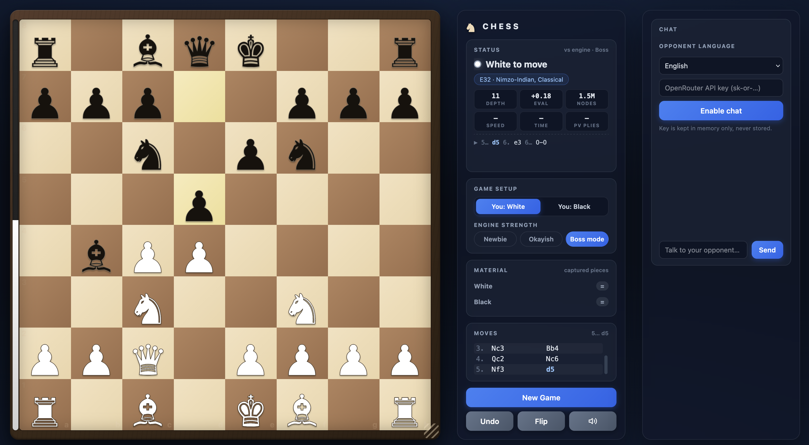

# Chess Buddy

Your next chess opponent lives in a single HTML file.

Chess Buddy is a self-contained browser chess game with a built-in engine and optional opponent chat. Play as White or Black, watch the engine think, and pick a challenge—from Newbie to Boss mode.



Everything lives in one HTML file: layout, styles, chess rules, engine, and sound effects. No installation, build step, external libraries, or backend is required to play. Chess runs locally and works offline; only the optional chat needs an internet connection and an OpenRouter API key.

## Getting started

Open `index.html` in a modern browser.

Alternatively, from the repository directory, start a local server with Python 3:

```sh
python3 -m http.server 8000
```

Then visit [localhost:8000](http://localhost:8000/).

## Playing

- Choose **You: White** or **You: Black**, then select an engine strength.
- Click or tap a piece to see its legal moves, then select a destination. Promotion opens a piece picker.
- Use **Undo** to take back your move and the engine's reply once it has finished thinking.
- Use **Flip** to change the board orientation, or drag the board's resize handle to adjust its size.
- Toggle the speaker button to mute or enable sound effects.
- Select **New Game** to reset the board and clear the chat.

Changing sides continues the current position. Use **New Game** when you want to start over with the selected side.

### Engine strengths

| Level | Search time budget | Maximum depth | Behavior |
| --- | --- | --- | --- |
| Newbie | 200 ms | 2 plies | Large random score adjustments for weaker play |
| Okayish | 800 ms | 5 plies | Small random score adjustments |
| Boss mode | 2 seconds | 99 plies | No random score adjustments; searches until its time limit |

A ply is one move by one side. These are search limits, not guaranteed search depths or Elo ratings; actual depth depends on the position and device.

## Features

- **Chess rules:** castling, en passant, promotion, checkmate, and stalemate. The game also ends automatically for detected insufficient material, threefold repetition, and the fifty-move rule.
- **Live engine analysis:** evaluation bar, search depth, evaluated nodes, speed, elapsed time, and the engine's predicted continuation in standard algebraic notation.
- **Game tracking:** move history, captured pieces, material balance, and opening names matched against an embedded opening table.
- **Board presentation:** animated moves, a resizable board, and synthesized sound effects. Move animations respect reduced-motion preferences.
- **Optional opponent personality:** chat in 16 languages, with reactions to captures, checks, promotions, large evaluation swings, and game endings.

## Optional opponent chat

Choose an **Opponent language**, paste your OpenRouter API key into the chat panel, and select **Enable chat**. Send a message whenever you like, or let the opponent react to significant moments in the game. **Disable** turns chat off and clears the key from memory.

The configured chat model is `z-ai/glm-5.3-flash` (the `CHAT_MODEL` constant in `index.html`). The chess engine chooses every move; the language model supplies the conversation.

Chat requests go directly from your browser to OpenRouter and include your messages, recent conversation, and game context such as the move list, side to move, material balance, and game result. The API key is held in memory only and is never saved to browser storage. Reloading the page requires entering it again.

The browser saves engine strength, board size, sound, and chat-language preferences in `localStorage`. Games and chat history are not saved across reloads.

## How it works

`index.html` contains four main parts:

| Part | Responsibility |
| --- | --- |
| Inline CSS | Board, panels, animation, and responsive layout |
| HTML markup | Game controls, status, move list, chat, and promotion picker |
| `engine-src` script (`type="text/plain"`) | Chess engine source, loaded into a Web Worker through a Blob |
| Final script | Game state, legal moves, rendering, input, sound, chat, and worker communication |

The controller owns the position and sends the full move history to the worker for each search. The worker replays those moves and searches off the main thread, keeping the interface responsive.

Chess rules are deliberately implemented twice: the controller uses an 8×8 board of piece objects for validation and display, while the engine uses a typed-array mailbox board and packed moves for search. Rule changes may need updates in both places; evaluation and search changes usually belong only in the worker.

The engine uses iterative deepening with alpha-beta/PVS search, a transposition table, move ordering, quiescence search, and pruning. Its evaluation blends middlegame and endgame scores for material, piece placement, pawn structure, mobility, and king safety.

## Development and verification

Edit `index.html` and reload the browser. Keep the demo dependency-free and runnable directly from the file. See [AGENTS.md](AGENTS.md) for implementation details and project conventions.

There is no configured test suite, linter, or build system. For interface changes, play a short game and check the browser console. Exercise both sides, undo, new game, promotion, and any controls affected by the change. Engine syntax errors may only appear when its worker starts.

For move-generation changes, the worker accepts a `perft` request to count legal move sequences. Run this in the browser console while the page is open to check the starting position at depth 4 using a separate worker:

```js
const perftUrl = URL.createObjectURL(new Blob(
  [document.getElementById("engine-src").textContent],
  { type: "application/javascript" }
));
const perftWorker = new Worker(perftUrl);
perftWorker.onmessage = ({ data }) => {
  console.log(data); // Expected: { cmd: "perft", id: 1, count: 197281 }
  perftWorker.terminate();
  URL.revokeObjectURL(perftUrl);
};
perftWorker.postMessage({ cmd: "perft", id: 1, depth: 4 });
```

Expected starting-position counts are **20**, **400**, **8,902**, and **197,281** at depths 1–4 respectively. Pass a `fen` field in the request to check another position.
